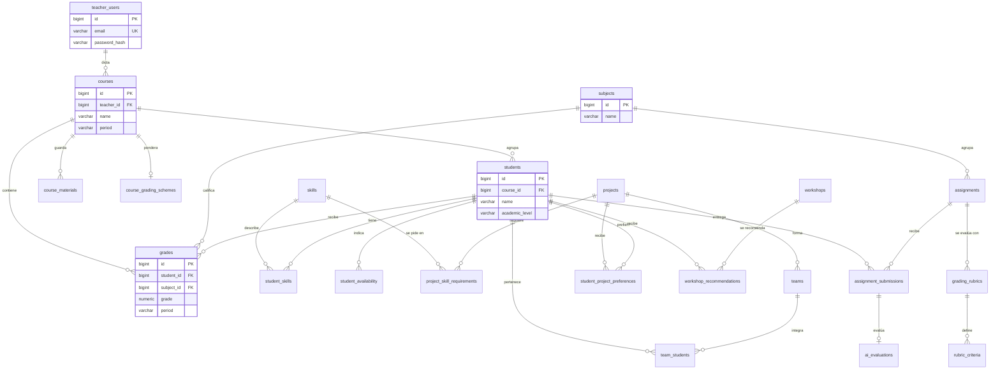

# Diagrama entidad-relación

Relaciones principales. Todas las tablas académicas tienen además `teacher_id → teacher_users.id`,
que se omite en el diagrama para que sea legible (ver [aislamiento](row-level-security.md)).

El detalle de cada columna está en el [diccionario de datos](data-dictionary.md).
